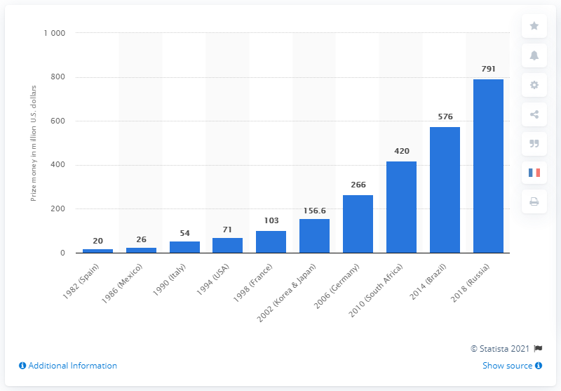

# Beginner's guide to the ChartAudit dataset

This guide explains what this dataset is, how it was made, what every folder and file holds, what one item looks like, and what the technical words mean. You don't need machine-learning experience to follow it.

## 1. The idea in one minute

We want to teach an AI model that can look at pictures (a *vision-language model*, or VLM) to answer questions about charts, like this one:



> **Question:** In the 1990s, what is the average prize money (in millions) in the USA and France?
> **Answer:** 87, because USA 1994 = 71, France 1998 = 103, and (71 + 103) / 2 = 87.

To teach the model, we need many examples of *question + chart → good answer*. This dataset is that collection of examples: **1,403 for training, 167 for validation and 180 for the final test**, each with its chart picture.

A good answer here isn't just a number. The model is taught to reply in a fixed JSON shape: the answer, which parts of the chart it used (*evidence*), and a one-sentence *rationale*. That makes answers easy to check and harder to fake.

## 2. How the dataset was made, step by step

| Step | What happened | Why |
|---|---|---|
| 1. Start from ChartQA | We began with the public ChartQA dataset (charts from Statista, Pew Research, Our World in Data and OECD) and kept only the questions that people wrote by hand. | Human questions are more natural than machine-made ones. |
| 2. Select a balanced sample | We picked about 1,800 questions, spread evenly over source, chart type (bar, line, pie), answer type and question type. About 5% are deliberately unanswerable (step 3). We kept ChartQA's own split so no chart appears in both training and test. | A balanced sample stops the model from only learning the most common case. |
| 3. Add "cannot answer" items | For some items we paired a question with the wrong chart. The correct reply is `null` plus a short refusal. | The model must learn to say "this chart doesn't show that" instead of guessing. |
| 4. Write the target answers | Each chart's data was turned into a text table. Claude Opus acted as a *teacher*: it read the table and the question and wrote the evidence and the rationale. A script then checked that the teacher's answer matched ChartQA's answer and that every piece of evidence points at something real in the chart data. | A checked teacher gives much better targets than raw answers alone. |
| 5. Remove disputed items | When the teacher thought ChartQA's own answer was wrong, the item was dropped and replaced by another from the same group. About 12% of answers were disputed. | Wrong answers would teach the model wrong things. |
| 6. Attach the chart picture | Each item now points to its chart image (a PNG file). The user message is *image + question*. | This is what makes it a VLM dataset. |
| 7. Image check | Claude Opus then looked at every train and val **picture** and answered two questions: can this be answered from the picture alone, and does the stored answer match what the picture shows? | Step 4 used a text table, not the picture, so this catches mistakes only visible in the image. It removed 46 train and 3 val items (mostly percentages stored as fractions, such as 0.64 for "64%"). |
| 8. Freeze (still to do) | Two people check 150 items by hand, then the dataset is tagged as frozen. | Human confirmation before we report any results. |

The scripts that did steps 2 to 5 are not in this repo, only their results. The checker used in steps 4 and 7 is `scripts/check_teacher.py`.

## 3. What every folder and file holds

```
.
├── README.md                        Short overview and one example record
├── docs/
│   └── BEGINNER_GUIDE.md           This guide
├── data/v1.0/
│   ├── image_only/                  Main setting: chart image + question
│   │   ├── train.jsonl              1,403 items to learn from
│   │   ├── val.jsonl                167 items to pick the best model/settings
│   │   ├── test.jsonl               180 items, locked: never train or tune on them
│   │   └── answer_only/             Same items, but the target is only the answer
│   ├── image_table/                 Easier setting: image + the chart data as text + question
│   │   ├── train.jsonl, val.jsonl, test.jsonl
│   │   └── answer_only/
│   ├── images/{train,val,test}/     The chart pictures, one PNG per chart (1,104 + 140 + 157)
│   ├── stats.json                   Counts per split, picture sizes, image-check results
│   ├── teacher_stats.json           How many items the teacher accepted, rejected, replaced
│   └── MANIFEST.txt                 A fingerprint (SHA-256) of every file, to detect changes
├── scripts/
│   └── check_teacher.py            Checks that evidence points at real cells, colours or titles
└── notebooks/
    └── 01_vlm_baselines.ipynb      Colab notebook: how well does an untrained VLM do on test?
```

**Pick the right files:**
- To train, use `image_only/train.jsonl` (or `image_table/train.jsonl` if you want the easier version).
- To choose between versions of your model, use `val.jsonl`.
- To report a final score, use `test.jsonl`, once, at the end.
- `answer_only/` is for an experiment: train one model on full targets and one on answer-only, then compare. If the full-target model scores higher, teaching it to show evidence and reasoning helped.

Each `.jsonl` file holds one item per line, and each line is one JSON object.

## 4. One item, field by field

This is the item behind the chart above, from `data/v1.0/image_only/train.jsonl` (shortened).

```json
{
  "id": "train-two_col_315-3611",
  "split": "train",
  "chart_id": "two_col_315",
  "image": "images/train/two_col_315.png",
  "source": "statista",
  "chart_type": "v_bar",
  "question": "In the 1990s, what is the average prize money (in millions) in the USA and France?",
  "answer": 87,
  "answer_type": "number",
  "question_type": "arithmetic_comparison",
  "target_status": "teacher_verified",
  "flags": {"image_readable": "yes", "...": "..."},
  "input_text": "Source: Statista\nChart type: vertical bar\n...| 1998 (France) | 103.0 |\n| 1994 (USA) | 71.0 | ...",
  "messages": [
    {"role": "system",    "content": "You are a chart analyst. Answer questions about the chart image provided. ..."},
    {"role": "user",      "content": [{"type": "image", "image": "images/train/two_col_315.png"},
                                      {"type": "text",  "text": "Question: In the 1990s, ... Respond with JSON: {...}"}]},
    {"role": "assistant", "content": "{\"answer\": 87, \"answer_type\": \"number\", \"unit\": \"million U.S. dollars\", \"evidence\": [\"Row=1994 (USA), Col=Prize money in million U.S. dollars (71.0)\", \"Row=1998 (France), Col=Prize money in million U.S. dollars (103.0)\"], \"rationale\": \"USA 1994 was 71 and France 1998 was 103; (71 + 103) / 2 = 87.\"}"}
  ]
}
```

| Field | Meaning |
|---|---|
| `id` | Unique name of this item. |
| `split` | `train`, `val` or `test`. |
| `chart_id`, `image` | Which chart this item shows, and where its picture is (path relative to `data/v1.0/`). |
| `source` | Where the chart came from: `statista`, `pew`, `owid` or `oecd`. |
| `chart_type` | `v_bar` (vertical bars), `h_bar` (horizontal bars), `line` or `pie`. |
| `question`, `answer` | The human question and the correct answer. |
| `answer_type` | `number`, `text`, `yes_no` or `unanswerable`. |
| `question_type` | `retrieval` (read one value), `arithmetic_comparison` (compute or compare), `visual_reference` (refer to colours or shapes), or `unanswerable`. |
| `target_status` | `teacher_verified` (the teacher wrote and a script checked the target) or `fixed_refusal` (a standard "cannot answer" reply). |
| `flags.image_readable` | From the image check: `yes` (values are printed or obvious), `approx` (you must estimate from the axis), `no` (the question can't be answered from this picture, which is correct for `unanswerable` items). |
| `input_text` | The chart's data as plain text. The model does not see it in `image_only`; it is kept so evidence can be checked. |
| `messages` | The training conversation: instructions (`system`), the question with the picture (`user`), and the reply the model should learn to give (`assistant`). |

In `image_table`, the `user` message also carries the `Chart data:` text before the question. In `answer_only`, the reply has `"evidence": []` and `"rationale": null`.

**Reading the evidence strings.** `Row=1994 (USA), Col=Prize money... (71.0)` means "the row labelled 1994 (USA), the column Prize money, which holds 71.0". Other forms are `Colour: Maximum price = dark blue` (a legend colour) and `Title` (the chart title). For a picture, think of rows as the labelled bars or points, and columns as the series in the legend.

**An "unanswerable" item** looks the same, except the picture belongs to a different chart than the question was written for, and the reply is `{"answer": null, "answer_type": "unanswerable", ...}`.

## 5. What to do next

1. **Run the baseline notebook** on a GPU (L4 or A100). It shows how well an untrained model does on `test`, so later you can show how much fine-tuning improved it.
2. **Human audit** of 150 train items by two people, then freeze the dataset.
3. **Fine-tune** with QLoRA on `train`, choose settings on `val`, and score once on `test`.

## 6. Glossary

| Word | Plain meaning |
|---|---|
| **ChartQA** | A public dataset of charts with questions and answers, the raw material here. |
| **VLM (vision-language model)** | An AI model that takes both pictures and text as input, such as Qwen2.5-VL. |
| **Fine-tuning** | Continuing a model's training on your own examples so it gets better at your task. |
| **QLoRA / LoRA** | A cheap way to fine-tune: the big model stays frozen (and compressed to 4-bit in QLoRA) and only small add-on layers are trained. It fits on a single GPU. |
| **Instruction–response pair** | One training example: what the user asks, and the reply we want. Each item here is one. |
| **Train / validation / test** | Train: examples the model learns from. Validation: examples used to compare versions of your model. Test: a locked exam used once for the final score. |
| **Baseline** | The score of the untrained model, to compare against after fine-tuning. |
| **Teacher model** | A strong model (here Claude Opus) that writes the target answers for a smaller model to learn from. |
| **Gold answer** | The human-written correct answer from ChartQA. |
| **Evidence** | The specific cells, colours or title the answer is based on. |
| **Rationale** | A short sentence explaining how the answer follows from the evidence. |
| **Grounded** | An answer that can be traced back to something actually in the chart. |
| **Unanswerable item** | A question the chart cannot answer; the right reply is `null`. |
| **Relaxed accuracy** | The score used for ChartQA: a numeric answer counts as correct if it is within 5% of the gold; text and yes/no must match after ignoring case and punctuation. |
| **JSON** | A text format for structured data, like `{"answer": 87}`. |
| **JSONL** | A file with one JSON object per line. |
| **Schema** | The agreed shape of the model's JSON reply (which fields it must have). |
| **Chat template** | The way a model expects system, user and assistant messages to be written out before training. |
| **Chart type codes** | `v_bar` vertical bar, `h_bar` horizontal bar, `line`, `pie`. |
| **Percent vs fraction mistake** | A gold answer stored as 0.64 when the chart shows 64%. Removed from train and val; test may still contain a few. |
| **SHA-256 / MANIFEST** | A file fingerprint. If a file changes, its fingerprint changes, so `MANIFEST.txt` proves nothing was altered. |
| **Frozen dataset** | A version nobody edits any more, so every experiment uses identical data. |
| **PNG** | The image file format used for the charts. |
| **Colab** | Google's free online notebook with GPUs, where the baseline notebook runs. |
| **GPL-3.0** | The licence of ChartQA; this derived dataset carries the same licence. |
